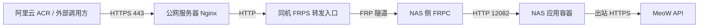

# 构建与部署

## 日常工作流

用户将代码推送到 Git，阿里云 ACR 自动使用项目根目录的 Dockerfile 构建镜像。部署主机通过 `docker-compose.yml` 拉取并启动该镜像。

后续每次修改代码不主动尝试本地 Docker 打包，默认只运行 Python 回归和 Compose 配置校验。本文的本地构建与容器验证命令供需要时手动使用。

## 职责划分

Dockerfile 只选择基础镜像、安装依赖、复制运行代码；没有应用启动命令、EXPOSE、挂载或健康检查。构建不依赖 Compose 或其他配置文件。Compose 只引用已构建的镜像，没有 `build:`，集中管理应用命令、端口、环境变量、健康检查与重启策略。

基础 Python 镜像可能自带 CMD；本项目不依赖它。直接 `docker run 镜像` 不会启动本服务，部署使用 Compose。

## NAS、FRP 与公网 HTTPS 链路

用户确认的实际部署方式：应用镜像运行在家中 NAS，FRPC 从 NAS 侧连接公网服务器的 FRPS，公网服务器上的 Nginx 负责域名入口、HTTPS 证书与反向代理。

请求进入的方向如下；FRPC 主动建立到 FRPS 的隧道：



| 组件 | 职责与连接目标 |
| --- | --- |
| NAS 应用 Compose | 保持 HTTP 服务与 `12082:12082` 映射，无需在应用镜像内配置证书 |
| NAS 侧 FRPC | 将隧道请求转到它能访问的应用 HTTP 地址 |
| 公网 FRPS | 接受 FRPC 连接，向同机 Nginx 提供转发入口 |
| 公网 Nginx | 监听 HTTPS、加载证书、将请求代理到 FRPS 转发入口 |
| 阿里云 ACR | 调用公网域名的 `/payload_acr`；不直接填写 NAS 内网地址 |

Nginx 终止外部 HTTPS 后，后端应用继续使用 HTTP。FRP 隧道自身的传输加密由 FRP 配置独立决定。此拓扑不要求把本项目改成 HTTPS 服务，也无需向应用镜像挂载证书。

### FRPC 如何访问应用

- FRPC 在 NAS 宿主机上运行，或 Linux host 网络容器中运行：可以连接 `127.0.0.1:12082`，前提是应用端口已经按 Compose 发布到 NAS。
- FRPC 在 Docker bridge 网络容器中运行：其 `127.0.0.1` 指向 FRPC 容器自身。应连接可访问的 NAS 地址和宿主端口；若与应用加入同一个 Docker 网络，也可用该网络内的应用服务名及容器端口 12082。
- FRPC 位于家中另一台设备：连接 NAS 的局域网地址和宿主端口 12082。

因此当前端口映射保持不变，不擅自改成仅绑定 NAS 回环地址，以免阻断已有 FRPC 的访问。具体 FRPC 运行方式、地址与网络尚未提供。

### Nginx 与 FRPS 如何衔接

具体配置取决于已有 FRP 代理类型，不替换用户现有的 FRP/Nginx 配置：

- 若使用 FRP TCP 代理：Nginx 的 HTTP upstream 指向 FRPS 为此服务映射的 TCP 端口。
- 若使用 FRP HTTP 代理：Nginx 指向 FRPS 的 `vhostHTTPPort`，并保留原始 `Host`，使其与 FRPC 的 `customDomains` 匹配。

FRP 的 HTTPS 代理类型通常要求后端提供 HTTPS，FRPS 不负责终止 TLS；当前由 Nginx 终止 HTTPS，后端按现有 TCP/HTTP 代理方式连接即可。参见 [FRP 官方 HTTP/HTTPS 代理说明](https://gofrp.org/en/docs/examples/vhost-http/)。

Nginx 转发应保留 `/payload_acr` 路径及 `secret` 查询参数，避免把地址改写成旧路径。以专用域名转发到 FRPS 为例，`proxy_pass http://<FRPS入口地址>:<转发端口>;` 不附加新的 URI，且不额外重写请求。HTTP 代理模式还需 `proxy_set_header Host $host;`。可按实际部署设置 `X-Forwarded-Proto $scheme`；应用如需信任代理头，还要按实际来源配置 Uvicorn 的可信代理地址，不默认信任所有来源。参见 [Nginx proxy_pass](https://nginx.org/en/docs/http/ngx_http_proxy_module.html#proxy_pass) 与 [proxy_set_header](https://nginx.org/en/docs/http/ngx_http_proxy_module.html#proxy_set_header)。

Nginx 与 FRPS 若分别运行在不同的 bridge 网络容器中，Nginx 的 `127.0.0.1` 同样不是 FRPS；应使用实际可达的 FRPS 地址。公网域名、证书路径、FRP 代理类型和端口、各组件容器网络尚未提供，以上只记录连接要求，不视为已经核验线上配置。

### 按层检查

1. 在 NAS 上访问 `http://127.0.0.1:12082/health`，确认应用与端口映射正常。
2. 从 FRPC 所在环境访问其实际配置的应用地址，确认容器网络或局域网可达。
3. 从 Nginx 所在环境访问 FRPS 转发入口的 `/health`；HTTP 代理模式带上实际业务域名的 `Host`。
4. 从外网访问 `https://你的域名/health`，确认 DNS、证书和完整代理链路。
5. 在 ACR 控制台测试 `https://你的域名/payload_acr?secret=已编码的密钥`，再核对 MeoW 结果与手机收件。

前四步不会发送通知；第五步会触发真实通知，由用户部署后执行。本次仅维护文档，没有连接 NAS 或公网服务器。

## 直接配置 Compose

直接编辑根目录 `docker-compose.yml`：

| 位置 | 用途 | 当前值 |
| --- | --- | --- |
| `services.path-scanner.image` | ACR 自动构建的应用镜像 | 保留原 ACR 仓库的 `latest` |
| `ports` | 宿主机端口与容器端口 | `12082:12082` |
| `environment.MIAO_NICKNAME` | 有效的 MeoW 昵称 | 占位值 `XXXX`，部署前填写 |
| `environment.MIAO_API_BASE` | MeoW API 基地址 | `https://api.chuckfang.com` |
| `environment.DEFAULT_TITLE` | 手动通知默认标题 | `MeoW` |
| `environment.WEBHOOK_SECRET` | 可选共享密钥 | 空，表示不开启校验 |
| `environment.DEFAULT_JUMP_URL` | 可选通知跳转地址 | 空 |
| `environment.LOG_LEVEL` | 日志级别 | `INFO` |

不需要额外环境文件；配置值不使用 `${...}` 插值。应用仍然从容器环境读取配置，Compose 的 `environment` 直接提供这些值。

保留原有服务键 `path-scanner`、容器名 `harmonyos-msg-push`、默认宿主端口 12082 和 `restart: always`，便于原地升级。容器内始终监听 `0.0.0.0:12082`，若要改宿主机端口，只改 `ports` 左侧数字。

## 部署与更新

ACR 完成 Git 自动构建后，在部署主机放置并编辑好 Compose 文件，再按需登录 ACR 并执行：

```bash
docker compose config --quiet
docker compose pull
docker compose up -d --pull never
docker compose ps
curl --noproxy '*' http://localhost:12082/health
docker compose logs --tail=100 -f path-scanner
```

`up -d` 会在镜像或配置变化后重新创建容器；单独 `restart` 不会重新载入修改后的环境变量。程序不用 `/data`，原 Compose 中无关的 NAS 挂载已经移除，不会主动删除宿主机原目录。

健康检查访问容器内 `/health`，每 30 秒一次，启动宽限 10 秒，超时 5 秒，连续失败 3 次标记 unhealthy。unhealthy 本身不会触发 Docker 自动重启；重启策略在进程退出时生效。

## ACR 地址迁移

将阿里云 ACR 控制台、反向代理及调用脚本里的 Webhook 地址统一改为：

```text
https://你的域名/payload_acr?secret=与你Compose配置一致的URL编码密钥
```

未配置密钥时可省略 `secret` 参数。旧接口已移除。先准备新镜像与 Compose 配置，再在维护窗口更新服务及 ACR 地址，最后从 ACR 控制台触发测试。只有真实 MeoW 返回成功且手机收到消息，才算外部收件验证完成。

ACR 的“根据 Git 构建镜像”和本服务的“接收 ACR Webhook 后通知”是两个环节；本服务不负责执行构建、拉取或自动替换运行容器。

新增 Codex 服务端接口为 `POST /payload_codex`。若现有 Nginx 或其他入口只允许指定路径，需要补充放行该路径，并保留 `secret` 查询参数。该接口沿用当前端口、FRP 与 Nginx HTTPS 拓扑，不增加部署参数；请求协议见 [接口说明](接口说明.md#codex-本轮处理完成通知)。

## 回滚

保留先前镜像的版本号或 digest。回滚时直接把 Compose 中 `image` 改回对应版本，再执行 `pull` 和 `up -d --pull never`。回滚到旧接口版本时需同步恢复 ACR Webhook 地址。

## ACR 构建报依赖版本不存在

2026-10-21 的 ACR 构建日志在安装依赖时报告 `No matching distribution found for fastapi==0.156.4`，同时列出的候选版本最高为 `0.156.2`。已把 `requirements.txt` 中 FastAPI 固定为 `0.156.2`，保留其他依赖、基础镜像、安装源与 Dockerfile。

该日志能确认的是：当时该构建环境未找到指定版本；它不能单独证明具体是镜像同步、缓存还是节点差异。官方 PyPI 的 [0.156.4 元数据](https://pypi.org/pypi/fastapi/0.156.4/json) 与 [0.156.2 元数据](https://pypi.org/pypi/fastapi/0.156.2/json) 均声明 Python `>=3.10`，因此不能仅据此将报错归因为 Python 3.10 不受支持。本机索引查询与云端日志的可见版本不同，不把本机安装成功当作 ACR 已验证成功。日志中的 pip 升级提示也不是此次中断的直接报错。

后续修改依赖时，可以只下载目标平台的 wheel 来检查版本、依赖约束和二进制包可用性，无需构建 Docker：

```bash
.venv/bin/python -m pip download \\
  -r requirements.txt \\
  --index-url https://mirrors.aliyun.com/pypi/simple/ \\
  --python-version 3.10.1 --platform manylinux2014_x86_64 \\
  --implementation cp --abi cp310 --only-binary=:all: \\
  --dest /tmp/harmonyos-acr-py310-wheels
```

该检查使用本机 pip 的目标平台解析，不在目标 Python 中运行代码，也不复现 ACR 构建节点的索引状态。参见 [pip download 官方说明](https://pip.pypa.io/en/stable/cli/pip_download/)。完成接口回归后，由用户推送修改后的 Git 提交，再由 ACR 自动构建，以新的云端日志确认最终结果。

## 可选：手动构建

这些命令不是日常改代码后的必要步骤。构建在项目根目录执行，使用 Dockerfile 即可，不需要 Compose：

```bash
docker build --platform linux/amd64 -f Dockerfile -t harmonyos-msg-push:local .
```

默认保留原 ACR Python 3.10 基础镜像。本次检查该镜像为 `linux/amd64`、Python 3.10.1，因此上面的命令显式选择 amd64；在 amd64 主机上可省略 `--platform`。若仓库为私有仓库，需要在自己的环境中完成 ACR 登录。

本次 macOS 客户端首次拉取时，ACR 令牌请求出现 `malformed HTTP response`。临时禁用构建客户端的 HTTP/2 后已成功构建，未修改 Docker 登录、系统代理或守护进程设置。遇到相同报错时可执行：

```bash
GODEBUG=http2client=0 docker build --platform linux/amd64 \
  -f Dockerfile -t harmonyos-msg-push:local .
```

也可替换基础镜像，不改 Dockerfile 或 Compose。公开 Python 镜像支持本次验证过的 arm64 和 amd64，以下命令按本机默认架构构建：

```bash
docker build -f Dockerfile \
  --build-arg BASE_IMAGE=python:3.10-slim \
  -t harmonyos-msg-push:local .
```

构建使用原阿里云 PyPI 镜像源。`requirements.txt` 固定验证过的运行依赖及间接依赖。镜像只复制 `main.py`、`app/` 与 `requirements.txt`，不打包文档、测试、环境文件或本地 Python 字节码；修改业务代码可复用依赖安装层。

手动构建出的本地镜像需要部署时，可直接把 Compose 的 `image` 改为 `harmonyos-msg-push:local`，再执行 `up -d --pull never`，无需另写构建配置。

## 本地开发与检查

需要 Python 3.10 或更高版本。直接启动时先在 shell 中配置环境变量：

```bash
python3 -m venv .venv
.venv/bin/python -m pip install -r requirements-dev.txt
export MIAO_NICKNAME='你的昵称'
export WEBHOOK_SECRET='你的密钥'
.venv/bin/python -m uvicorn main:app --host 0.0.0.0 --port 12082 --reload
```

也支持 `.venv/bin/python main.py`。日常检查：

```bash
.venv/bin/python -m unittest discover -s tests -v
docker compose config --quiet
```

回归测试 mock 外部请求，不向真实账号推送通知。

## 可选：手动容器验证

仅检查临时测试配置，不打包镜像、不启动容器：

```bash
python3 tests/compose_smoke.py --config-only
```

用户明确需要实际容器验证，且本地已有镜像时，可手动执行：

```bash
python3 tests/compose_smoke.py --image harmonyos-msg-push:local
```

脚本从实际 Compose 读取配置，生成独立临时测试配置，替换为 fake 账号、本地镜像、唯一容器名、回环地址的随机端口及内部模拟 MeoW；验证真实 HTTP 转发后清理临时容器和网络。不更换现有部署，不拉取或发布镜像。脚本使用 `up --wait`，需要支持该选项的 Compose v2 或更高版本。

## 官方参考

- [Compose 服务命令和运行配置](https://docs.docker.com/reference/compose-file/services/)
- [Docker 构建缓存与上下文建议](https://docs.docker.com/build/building/best-practices/)
